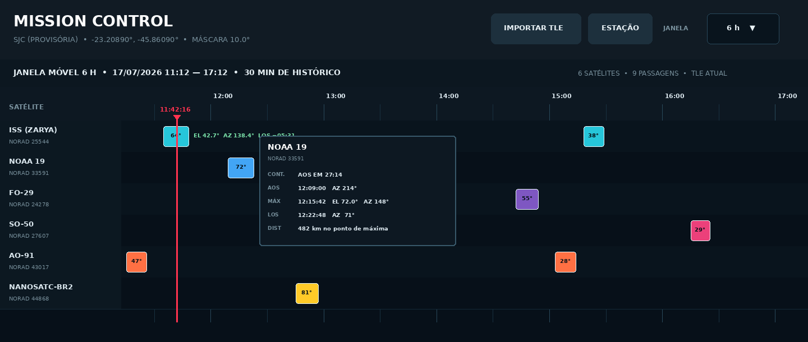

# Mission Control Timeline

**English** | [Português (Brasil)](README.pt-BR.md)

A Windows desktop timeline for **satellite passes over a ground station**. Add NORAD catalog numbers, set your station and elevation mask, and follow AOS, maximum elevation and LOS in a continuously updated view.

**Author:** Mario Pin, PU2PTU · **Application:** 0.9.0

*Illustrative preview included in the repository; the live interface may differ.*

## Features

- Moving timelines of **3, 6, 8, 12 or 24 hours**, with a marker for the current time and a 15-minute history window.
- Pass details: AOS, LOS, peak elevation, azimuths and distance; live elevation, azimuth and time to LOS for satellites in view.
- Next-pass countdown across the satellite list, searching 24 hours ahead regardless of the visible timeline scale.
- Optional two-minute AOS audio alert and one beep per second during the last five seconds; a persistent sound mute control.
- Orbital propagation with **SGP4**; automatic orbital data refresh from **CelesTrak** and **SatNOGS fallback** where data are available.
- Setup for NORAD list, WGS84 station, elevation mask, language and data folder. English is the app default; Portuguese, Spanish, Italian, French and German are also available.
- Local orbital cache for later offline use, with an indication when data are old.

## Requirements and libraries

| How to run | Requirements |
| --- | --- |
| Windows installer | Windows desktop; the packaged application includes its Python runtime and dependencies. |
| From source | **Python 3.10+** with Tcl/Tk (`tkinter`), plus `sgp4>=2.23,<3` from [`requirements.txt`](requirements.txt). |
| Build an executable | Dependencies in [`requirements-build.txt`](requirements-build.txt), including PyInstaller 6; **Inno Setup 6** is optional for building an installer. |

There is **no Arduino, electronic assembly, pin assignment or USB controller** in this project. The station is entered as coordinates and an elevation mask; antennas, radios and rotors remain independent equipment.

## Installation

For a ready-to-run Windows package, check [Releases](https://github.com/mariopin80/Mission-Control-Timeline/releases). To run the checked-out source on Windows, install Python 3.10 or later with **Add Python to PATH** and Tcl/Tk, then double-click `run_windows.bat`. On first use the script creates `.venv` and installs the orbital library.

To build locally, run `build_windows.bat`. The PyInstaller output is `dist\MissionControlTimeline\MissionControlTimeline.exe`; if Inno Setup 6 is installed, the script also produces a Windows installer in `dist-installer\`. The installed executable does not require a separate Python installation.

## How to use

1. Open **Setup** and enter NORAD catalog numbers in the **Satellites** tab. Separate them with commas, semicolons, spaces or new lines, for example `25544, 43786, 27607`. Names and duplicate catalog numbers are rejected.
2. Set the station's **actual latitude, longitude and elevation**, plus an elevation mask reflecting local horizon obstructions. The sample station is only a starting value; the default mask is **10°**.
3. Choose the timeline scale and, if desired, a language and sound alerts. Save the settings. Use **Update** to request fresh orbital data; the application also refreshes automatically after about 24 hours.
4. Click a pass bar for its AOS, peak and LOS details. Follow live data on a satellite row while it is above the mask. The header shows the next pass and countdown.
5. In **Setup > Storage**, choose or open the data folder. Changing it can copy the configuration, NORAD list and orbital cache to the new location.

The default data location on Windows is `%LOCALAPPDATA%\MissionControlTimeline\`, containing `config.json`, `satellites.txt` and `orbital_cache.json`. A custom folder may be selected during installation or in Setup. Do not edit `orbital_cache.json` by hand. Initial acquisition of new catalog numbers requires internet; a valid existing cache allows pass calculations without a connection. The map does not appear here: this project is a timeline, not a hardware control panel.

## Orbit and interpretation

Orbital data age, system clock, station coordinates and local horizon mask affect pass predictions. The program uses GMST/WGS-84 for its TEME-to-ECEF conversion; polar motion and UT1 corrections are not applied. Use the results for observation planning, and consult the [verification notes](VERIFICATION.md) for technical scope.

The application is distributed under its own [freeware license](LICENSE.txt), with [terms](TERMS_OF_USE.txt) and [privacy notice](PRIVACY_NOTICE.txt). Language-specific copies are in [`licenses/`](licenses/). The software and third-party orbital services have separate terms.
