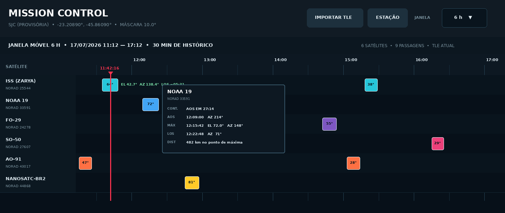

# Mission Control Timeline

[English](README.md) | **Português (Brasil)**

Aplicativo Windows com **linha do tempo das passagens de satélites** sobre uma estação terrena. Informe números de catálogo NORAD, configure a estação e a máscara de elevação e acompanhe AOS, elevação máxima e LOS em uma janela atualizada continuamente.

**Autor:** Mario Pin, PU2PTU · **Aplicativo:** 0.9.0

*Prévia ilustrativa incluída no repositório; a interface em execução pode diferir.*

## Recursos

- Linha do tempo móvel de **3, 6, 8, 12 ou 24 horas**, marcador do instante atual e janela com 15 minutos de histórico.
- Detalhes das passagens: AOS, LOS, elevação máxima, azimutes e distância; elevação e azimute ao vivo e tempo até o LOS para satélites em visada.
- Contagem regressiva para a próxima passagem da lista, buscando até 24 horas adiante independentemente da escala exibida.
- Alerta sonoro opcional dois minutos antes do AOS e um bip por segundo nos últimos cinco segundos; botão de som com estado preservado.
- Propagação orbital **SGP4**; atualização automática pelo **CelesTrak** e **SatNOGS como contingência** quando houver dados disponíveis.
- Setup da lista NORAD, estação WGS84, máscara de elevação, idioma e pasta de dados. O aplicativo inicia em inglês e também oferece português, espanhol, italiano, francês e alemão.
- Cache orbital local para uso posterior sem internet, com aviso quando os dados envelhecem.

## Requisitos e bibliotecas

| Modo de execução | Requisitos |
| --- | --- |
| Instalador Windows | Computador Windows; o aplicativo empacotado inclui Python e dependências. |
| Pelos fontes | **Python 3.10+** com Tcl/Tk (`tkinter`) e `sgp4>=2.23,<3` de [`requirements.txt`](requirements.txt). |
| Gerar executável | Dependências de [`requirements-build.txt`](requirements-build.txt), incluindo PyInstaller 6; **Inno Setup 6** é opcional para criar instalador. |

Este projeto **não utiliza Arduino, montagem eletrônica, pinagem ou controladora USB**. A estação é configurada por coordenadas e máscara de elevação; antenas, rádios e rotores são equipamentos independentes.

## Instalação

Para um pacote Windows pronto, consulte [Releases](https://github.com/mariopin80/Mission-Control-Timeline/releases). Para executar os fontes no Windows, instale Python 3.10 ou superior com **Add Python to PATH** e Tcl/Tk e dê duplo clique em `run_windows.bat`. Na primeira execução, o script cria `.venv` e instala a biblioteca orbital.

Para gerar o programa localmente, execute `build_windows.bat`. O PyInstaller cria `dist\MissionControlTimeline\MissionControlTimeline.exe`; com Inno Setup 6 instalado, o script também gera o instalador em `dist-installer\`. O executável instalado dispensa Python separado.

## Como usar

1. Abra **Setup** e informe os números NORAD na aba **Satellites/Satélites**. Separe por vírgulas, ponto e vírgula, espaços ou linhas: `25544, 43786, 27607`. Nomes e números duplicados são rejeitados.
2. Ajuste **latitude, longitude e altitude reais da estação**, além da máscara de elevação conforme as obstruções do horizonte local. A estação inicial é provisória; a máscara padrão é **10°**.
3. Escolha a escala da linha do tempo, idioma e alertas de som. Salve. Use **Atualizar** para solicitar novos dados orbitais; o aplicativo também atualiza automaticamente após cerca de 24 horas.
4. Clique na faixa de uma passagem para ver AOS, máxima elevação e LOS. A linha do satélite em visada mostra dados ao vivo; o cabeçalho exibe a próxima passagem e a contagem regressiva.
5. Em **Setup > Armazenamento**, escolha ou abra a pasta de dados. Ao mudá-la, as configurações, a lista NORAD e o cache orbital podem ser copiados para o novo local.

No Windows, a pasta padrão é `%LOCALAPPDATA%\MissionControlTimeline\`, com `config.json`, `satellites.txt` e `orbital_cache.json`. Outra pasta pode ser escolhida na instalação ou no Setup. Não edite manualmente `orbital_cache.json`. A primeira obtenção de novos catálogos precisa de internet; com cache válido, as passagens podem ser calculadas offline. Este projeto mostra a linha do tempo, sem mapa ou controle direto do hardware da estação.

## Órbita e interpretação

A idade dos dados orbitais, o relógio do computador, as coordenadas e a máscara do horizonte afetam as previsões. A conversão TEME–ECEF usa GMST/WGS-84, sem correções de movimento polar e UT1. Use os resultados no planejamento de observações e consulte as [notas de verificação](VERIFICATION.md) para o escopo técnico.

O programa é distribuído sob [licença freeware própria](LICENSE.txt), com [termos de uso](TERMS_OF_USE.txt) e [aviso de privacidade](PRIVACY_NOTICE.txt). Cópias traduzidas estão em [`licenses/`](licenses/). O software e os serviços orbitais de terceiros têm termos distintos.
